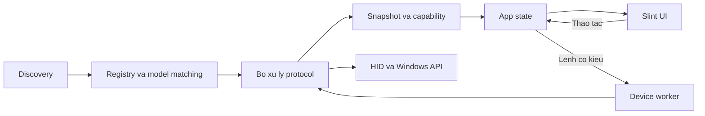

# Kiến trúc và cấu trúc code

Phase 1 đã có Rust/Slint, inventory HID, Windows identity, registry và worker. Contract điều khiển và protocol vẫn dành cho Phase 2. Kết quả kiểm chứng nằm trong [báo cáo Phase 1](phase-1-report.md); scope sản phẩm nằm trong [PROJECT.md](../PROJECT.md).

## 1. Hình dạng hệ thống

Một executable, một Cargo package. UI và app state ở main thread; device worker xử lý I/O. Tách model, protocol và capability để thêm thiết bị có phạm vi thay đổi rõ ràng.



Đây là luồng logic. Discovery, registry resolution cần I/O và protocol chạy trong worker; thông tin đưa về UI là dữ liệu sở hữu độc lập, không phải device handle.

## 2. Cấu trúc đích

Các file đánh dấu `[planned]` chưa tồn tại. Những module Phase 1 bên dưới đã có implementation; README giải thích trách nhiệm từng thư mục.

```text
OpenGearHub/
├── README.md
├── PROJECT.md
├── AGENTS.md
├── LICENSE
├── Cargo.toml
├── Cargo.lock
├── build.rs
├── src/
│   ├── README.md
│   ├── main.rs
│   ├── app.rs
│   ├── devices/
│   │   ├── mod.rs
│   │   ├── types.rs
│   │   ├── discovery.rs
│   │   ├── registry.rs
│   │   ├── worker.rs
│   │   ├── driver.rs                  [planned: giai đoạn 2]
│   │   ├── models/
│   │   │   └── README.md
│   │   └── protocols/
│   │       └── README.md
│   └── platform/
│       ├── README.md
│       ├── mod.rs
│       └── windows.rs
├── ui/
│   ├── README.md
│   ├── main.slint
│   └── controls/
│       └── README.md
├── tests/
│   └── fixtures/
│       └── README.md
└── docs/
    ├── architecture.md
    ├── roadmap.md
    ├── adding-device.md
    ├── supported-devices.md
    ├── verification.md
    └── phase-1-report.md
```

## 3. Trách nhiệm và giới hạn

| Thành phần | Sở hữu | Ranh giới |
| --- | --- | --- |
| `main` | Khởi tạo, wiring, chạy và kết thúc app | Không chứa giao thức hoặc điều phối theo model |
| `app` | Trạng thái hiển thị, lựa chọn thiết bị, pending/result, callback UI | Không encode report hoặc truy cập handle |
| `devices::types` | Identity, descriptor, capability, snapshot; command/result khi cần | Không phụ thuộc Slint hoặc kiểu FFI của Windows |
| `discovery` | Inventory và chuẩn hóa metadata/interface | Không tự suy ra thiết bị điều khiển được |
| `registry` | Đăng ký mapping và chọn bộ xử lý | Không thực thi lệnh ghi; match mơ hồ không được chọn tùy ý |
| `worker` | Context/handle, hàng đợi, vòng đời kết nối, thực thi tuần tự | Không chứa nhánh riêng theo hãng/model hoặc kiểu UI |
| `models` | Điều kiện match, protocol tương ứng, giới hạn và quirks đã xác minh | Không chứa vòng lặp I/O hoặc code UI |
| `protocols` | Encode/decode, đọc trạng thái, kiểm tra lệnh, xác nhận theo giao thức | Không phụ thuộc app state hoặc component Slint |
| `platform` | Identity, notification, audio và API Windows cần thiết | Không quyết định bố cục UI hoặc hỗ trợ model |
| `ui` | Hiển thị và chuyển tiếp thao tác qua callback | Không chứa VID/PID, USB report hoặc điều kiện theo tên hãng |

Phụ thuộc hướng từ app đến devices/platform; phần devices/platform không import app hoặc Slint. Module FFI trả dữ liệu Rust sở hữu độc lập. Không thêm layer hoặc trait chỉ để bọc một hàm có sẵn.

## 4. Cơ chế mở rộng

### Model và protocol

- Model specification khai báo điều kiện nhận diện, protocol, connection và giới hạn có bằng chứng.
- Nhiều model dùng chung protocol nếu format và hành vi thực sự tương thích. Tổ chức protocol theo họ giao thức thay vì sao chép theo tên hãng.
- Registry có một nơi đăng ký rõ ràng. Không cần macro tự đăng ký hoặc runtime plugin loader ở giai đoạn đầu.
- Metadata có thể thiếu. Không gộp thiết bị chỉ bằng VID/PID; dùng identity Windows khi phù hợp và giữ interface chưa nhóm rõ ràng.
- Container ID hỗ trợ nhóm chức năng của thiết bị Windows; receiver có thể đại diện nhiều thiết bị logic, cần mapping theo giao thức.
- Chỉ cấp quyền điều khiển sau khi xác minh model/interface/connection và các điều kiện firmware có ảnh hưởng. Probe nếu cần phải là thao tác đọc đã biết, không dò bằng lệnh ghi.

### Contract điều khiển

Giai đoạn 2 mới xác định contract bằng thiết bị thật đầu tiên. Điểm mở rộng dự kiến là một trait `DeviceDriver`: cung cấp capability/giới hạn, đọc snapshot và thực thi command có kiểu. Worker có thể sở hữu `Box<dyn DeviceDriver>` để gọi các implementation qua cùng contract.

Thiết kế factory/registry có thể thay đổi theo protocol đầu tiên; không khóa chữ ký API khi chưa có dữ liệu thực. Không tạo implementation giả để quảng cáo hỗ trợ phần cứng.

### Capability và UI

- Capability thể hiện tính năng cùng giới hạn, ví dụ khoảng DPI hoặc các chế độ RGB hợp lệ.
- UI sử dụng control đã biên dịch cho capability tương ứng; thêm model cùng capability không cần component UI riêng.
- Command là enum/struct có kiểu. Worker/driver validate lại capability và giá trị; việc disable control ở UI không thay thế validation.
- Trạng thái đang yêu cầu và trạng thái phần cứng đã xác nhận là hai dữ liệu khác nhau. Không ghi nhận thành công toàn bộ trước khi có kết quả phù hợp.
- Device identity và phiên kết nối phải ngăn lệnh cũ chạy trên thiết bị thay thế sau disconnect/reconnect.

## 5. I/O và vòng đời

- Một worker ban đầu; tuần tự hóa thao tác trên cùng thiết bị.
- UI gửi lệnh qua hàng đợi dung lượng 1 bằng `try_send`. Chỉ một refresh đang chạy; yêu cầu lặp bị bỏ qua khi busy. Result queue cũng có giới hạn 1.
- Worker chuyển snapshot/error về main thread qua event loop an toàn của Slint; callback giữ weak handle để tránh chu kỳ tham chiếu.
- Discovery không chạy theo frame. Giai đoạn 1 quét lúc mở app và refresh thủ công; notification/polling là công việc riêng khi cần.
- Timeout phải kiểm tra theo từng API/backend. `read_timeout` không bảo đảm mọi feature report, write hoặc enumeration hủy được; thread riêng không tự cung cấp cancellation.
- Shutdown đặt cờ closed, đóng command sender và chỉ join worker đã hoàn tất. Nếu enumeration chưa xong thì detach; kết quả không được áp dụng lên UI đã đóng. Đây là best-effort cleanup, không phải bảo đảm hủy I/O. Không có process/service phụ.
- Không retry vô hạn; không tự retry lệnh ghi chưa rõ tính idempotent.

## 6. Phạm vi thay đổi khi mở rộng

| Thay đổi | Phần dự kiến cần chạm |
| --- | --- |
| Model mới, protocol/capability đã có | Model mapping, đăng ký nếu cần, fixture và bảng tương thích |
| Protocol mới | Implementation protocol, registry/factory, test và tài liệu |
| Capability mới | Kiểu command/state, implementation driver, control UI và test liên quan |
| Transport/API mới | Adapter phù hợp, discovery/identity khi cần và kiểm chứng riêng |

Kiểm chứng kiến trúc ở giai đoạn 3: thêm model hãng thứ hai với capability hiện có mà không sửa UI/worker chung. Nếu phải sửa, rà lại ranh giới bằng vấn đề cụ thể trước khi tạo framework chung.

## Tham khảo

- [Rust trait objects](https://doc.rust-lang.org/book/ch18-02-trait-objects.html)
- [Slint threading và event loop](https://docs.rs/slint/1.18.1/slint/index.html#threading-and-event-loop)
- [Windows Container ID](https://learn.microsoft.com/en-us/windows-hardware/drivers/install/container-ids)
- [HID operations và timeout](https://docs.rs/hidapi/2.6.7/hidapi/struct.HidDevice.html)
